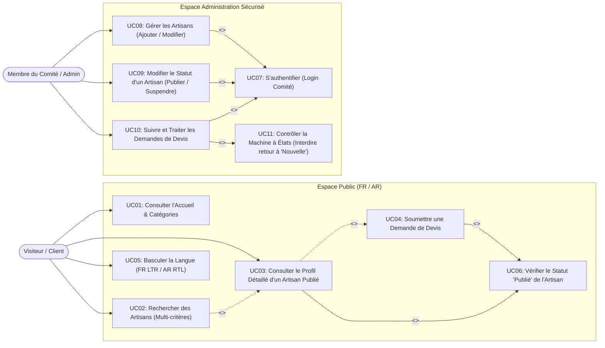
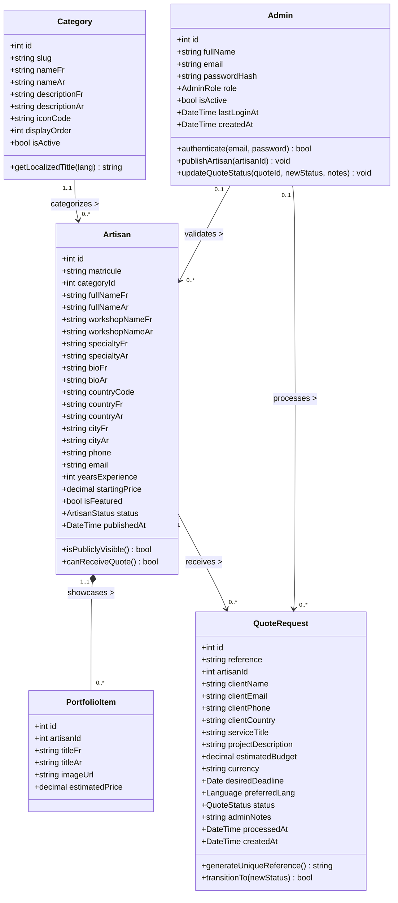
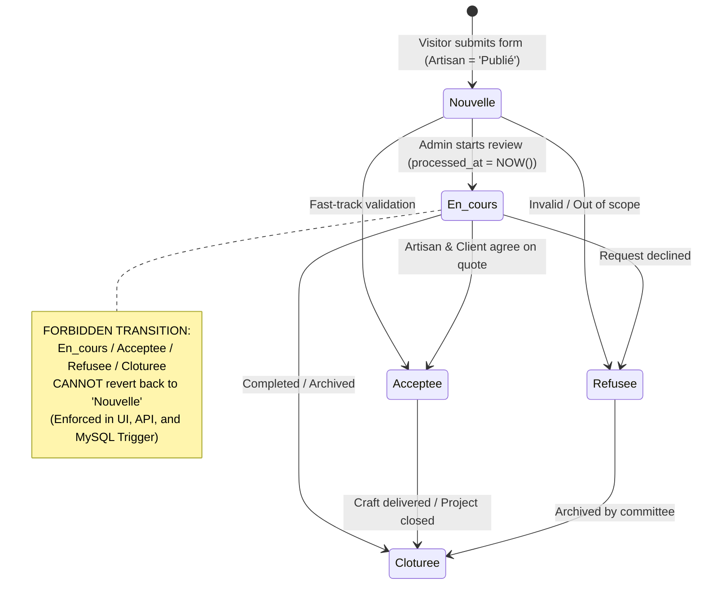
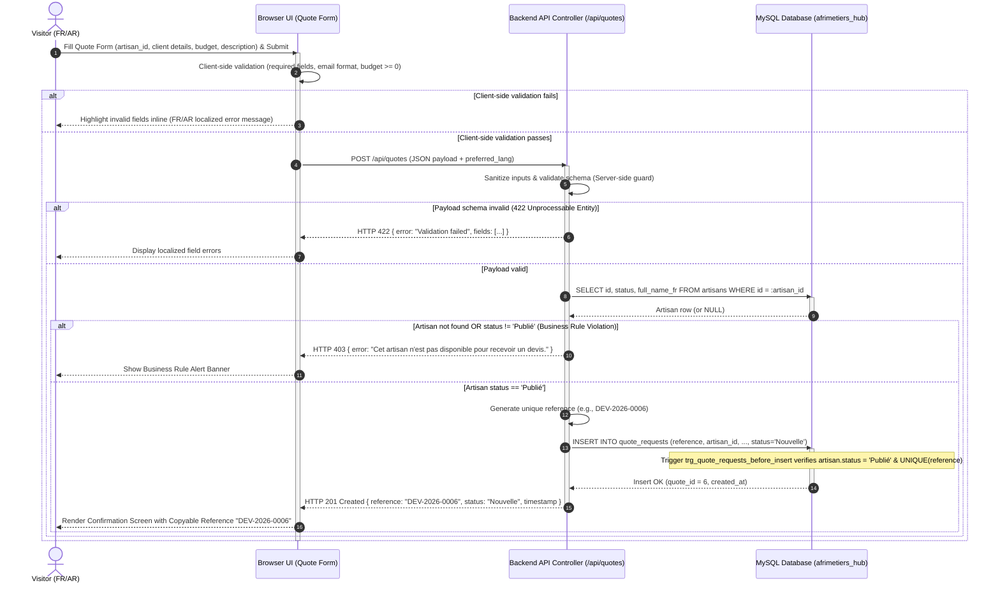

# AFRIMÉTIERS HUB — UML Analysis & System Architecture Documentation
**Competition:** African Skills Olympics 2026 (Format: 3-Day Intensive Web Development & Architecture)

---

## 1. Functional & Non-Functional Requirements Analysis

### 1.1 Functional Requirements (FR)

| ID | Space | Requirement Description | Business Rule / Enforcement |
| :--- | :--- | :--- | :--- |
| **FR-01** | Public | **Home Page Showcase:** Display featured artisans (`is_featured = 1`), craft categories, and platform KPIs in French and Arabic. | Only artisans with `status = 'Publié'` are rendered. |
| **FR-02** | Public | **Multi-Criteria Artisan Directory:** Search and filter artisans by Category, Country, City, and keyword (FR/AR). | Queries filter strictly on `status = 'Publié'`. |
| **FR-03** | Public | **Detailed Artisan Profile:** Present artisan biography, specialty, location, years of experience, portfolio items, and direct CTA to request a quote. | Direct URL access to a non-published artisan (`Brouillon`, `En attente`, `Suspendu`) returns `404 Not Found` / Access Denied. |
| **FR-04** | Public | **Quotation Request Submission ("Demande de devis"):** Allow visitors to submit a customized project quote linked to a specific published artisan. | Generates a unique reference (`DEV-2026-XXXX`), sets initial status to `'Nouvelle'`, and verifies target artisan is `'Publié'`. |
| **FR-05** | Public | **About & Contact Pages:** Present the African Skills Olympics 2026 mission, ethical charter, and committee contact details. | Fully localized in French (LTR) and Arabic (RTL). |
| **FR-06** | Admin | **Committee Authentication & Session Guard:** Secure login for Committee Members (`MembreComite`) and Super Administrators (`SuperAdmin`). | Protected by JWT/Session middleware, RBAC, and bcrypt/Argon2 password hashing. |
| **FR-07** | Admin | **Artisan Lifecycle Management:** Add, edit, and update the publication status of artisans (`Brouillon`, `En attente`, `Publié`, `Suspendu`). | Publishing an artisan stamps `published_at` and records `validated_by`. |
| **FR-08** | Admin | **Quotation Request Tracking & State Machine:** Filter incoming requests and update their processing status (`Nouvelle` -> `En cours` -> `Acceptée` / `Refusée` / `Clôturée`). | **Irreversible State Constraint:** Once a quote leaves `'Nouvelle'`, it can never revert to `'Nouvelle'`. |

---

### 1.2 Non-Functional Requirements (NFR)

1. **Security (NFR-SEC):**
   - **Input Validation & Parameterized Queries:** Strict server-side schema validation (Zod/Joi or PDO prepared statements) to prevent SQL Injection (SQLi) and Cross-Site Scripting (XSS).
   - **Authentication & Access Control:** Admin endpoints (`/api/admin/*`) protected by HTTP-only secure tokens, CSRF tokens, and role checks (`SuperAdmin`, `MembreComite`).
   - **Public Data Isolation:** Database views (`v_public_artisans`) and API serializers strip internal admin fields (`validated_by`, internal notes) from public responses.
   - **Rate Limiting:** Quote submission endpoint (`/api/quotes`) rate-limited (e.g., 5 requests / 15 min per IP) to prevent spam.

2. **Performance (NFR-PERF):**
   - **Database Indexing:** Composite B-Tree index `idx_artisans_public_search(status, category_id, country_code, city_fr)` ensures sub-50ms multi-criteria directory queries.
   - **Asset Optimization:** Lazy-loaded WebP images, responsive `srcset`, and zero-bloat CSS variables ensure First Contentful Paint (FCP) < 1.2s on 3G/4G African mobile networks.

3. **Mobile Accessibility & Bilingual i18n/RTL (NFR-A11Y):**
   - **Mobile-First Responsive Grid:** Touch targets $\ge 44 \times 44\text{ px}$, collapsible drawer navigation, and adaptive tables/cards from `320px` to `1440px+`.
   - **Native Bilingual Directionality:** Dynamic switching between `lang="fr" dir="ltr"` and `lang="ar" dir="rtl"` using CSS Logical Properties (`margin-inline-start`, `padding-inline-end`, `inset-inline-end`) and dedicated Arabic typography (`Cairo` / `Noto Kufi Arabic`).
   - **WCAG 2.1 AA Compliance:** Semantic landmarks (`<header>`, `<main>`, `<nav>`, `<section>`), `aria-live="polite"` form feedback, and contrast ratios $\ge 4.5:1$.

4. **Data Protection & Privacy (NFR-PRIV):**
   - **Data Minimization:** Only essential client contact data (`client_name`, `client_email`, `client_phone`, `project_description`) is collected for quote processing.
   - **Consent & Traceability:** Explicit GDPR/African Data Protection Convention consent checkbox on the quote form; audit timestamps (`created_at`, `processed_at`, `handled_by`) on every state change.

---

## 2. Use-Case Analysis

### 2.1 Actors
1. **Visiteur / Client (Public Actor):** Any unauthenticated user browsing the platform in French or Arabic, searching the directory, viewing published artisan profiles, and submitting quotation requests.
2. **Membre du Comité / Administrateur (Authenticated Actor):** Authorized member of the African Skills Olympics Committee managing artisan profiles, controlling publication statuses, and processing incoming quotation requests.

### 2.2 Use-Case Relationships (`<<include>>` & `<<extend>>`)

### 2.3 Detailed Use-Case Specifications Summary
- **`UC03` -> `UC04` (`<<extend>>`):** From a published artisan's detail page (`UC03`), the Visitor may optionally initiate a Quotation Request (`UC04`) pre-linked to that artisan's `id` and `matricule`.
- **`UC04` -> `UC06` (`<<include>>`):** Submitting a quote request (`UC04`) mandatorily includes verifying that the target artisan exists and has `status = 'Publié'` (`UC06`).
- **`UC08`, `UC09`, `UC10` -> `UC07` (`<<include>>`):** Every administration action mandatorily includes session authentication (`UC07`).
- **`UC10` -> `UC11` (`<<include>>`):** Updating a quote request status (`UC10`) mandatorily includes the state machine transition check (`UC11`) preventing any regression to `'Nouvelle'`.

---

## 3. UML Class Diagram & Domain Model

### Cardinalities & Domain Constraints
- **`Category (1..1) <--> (0..*) Artisan`:** Every artisan belongs to exactly one craft category (`1..1`); a category may contain zero or many artisans (`0..*`).
- **`Artisan (1..1) <--> (0..*) QuoteRequest`:** Every quotation request is linked to one and only one published artisan (`1..1`); a published artisan may receive zero or many quote requests (`0..*`).
- **`Artisan (1..1) *--> (0..*) PortfolioItem`:** Composition relationship — deleting an artisan cascades to its portfolio items.
- **`Admin (0..1) <--> (0..*) QuoteRequest`:** A newly created quote request has `0` assigned admin (`handled_by = NULL`) until processed by `1` committee member.

---

## 4. State Machine Diagram (Quote Request Lifecycle)

---

## 5. Sequence Diagram: Visitor Submits a Quote Request (With Validation & Error Handling)

Scenario: **"Visitor submits a quote request (Browser -> API -> Database -> Confirmation) with validation error handling."**

